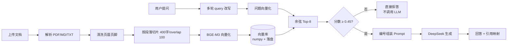

# RAG 知识库问答

一个从零手写的检索增强生成（RAG）知识库问答系统：上传文档 → 自动切片向量化 → 自然语言提问 → 返回带引用的回答；知识库中没有答案时明确拒答。

**不依赖 LangChain 等框架**，检索链路（切片、向量化、Top-K、阈值、引用映射）全部自己实现，每一步都有实测数据支撑参数选择。

> 完整技术讲解见 [`../docs/WALKTHROUGH.md`](../docs/WALKTHROUGH.md)（10 个部分，从 HTTP 请求讲到评估方法）。

## 架构



## 技术栈

| 层 | 选型 | 说明 |
|---|---|---|
| Web | FastAPI + Uvicorn | 自动生成 OpenAPI 文档 |
| LLM | DeepSeek（OpenAI 兼容） | `deepseek-chat` |
| Embedding | BGE-M3（Ollama） | 1024 维，多语言 |
| 向量存储 | numpy 暴力检索 | 76 块规模下 0.01ms，无需 ANN |
| 前端 | 原生 HTML + fetch + SSE | 无构建工具 |

## 快速开始

```bash
# 1. 依赖（Python 3.12+，需要 uv）
uv sync

# 2. 配置
cp .env.example .env
# 填入 DEEPSEEK_API_KEY

# 3. 启动 embedding 服务
docker run -d --name rag-ollama -p 11434:11434 \
  -v sc_ollama_data:/root/.ollama ollama/ollama:latest
# 或者本地已装 Ollama：ollama pull bge-m3

# 4. 把文档放进 data/uploads/ 后建立索引
uv run python scripts/rebuild_index.py

# 5. 启动服务
uv run uvicorn app.main:app --port 8000
```

- 聊天页面：http://127.0.0.1:8000/
- 接口文档：http://127.0.0.1:8000/docs

## API

| 方法 | 路径 | 说明 |
|---|---|---|
| POST | `/api/documents` | 上传文档（PDF/MD/TXT，≤20MB），自动切片入库 |
| GET | `/api/documents` | 文档列表 |
| DELETE | `/api/documents/{doc_id}` | 删除文档及其向量 |
| POST | `/api/chat` | RAG 问答，返回答案 + 引用 + token 用量 |
| POST | `/api/chat/stream` | SSE 流式问答：先发引用，再逐字输出 |
| GET | `/api/sessions/{id}` | 查看会话历史 |
| DELETE | `/api/sessions/{id}` | 清空会话 |

## 评估结果

评估集：25 条（21 条库内 + 4 条库外）。

### 阈值对比（Top-K=4）

| 阈值 | Recall@4 | 完全正确 | 可接受 | 库外拒答 | token |
|---|---|---|---|---|---|
| 0.50 | 81.0% | 81.0% | 85.7% | 100% | 18,972 |
| **0.45** | **85.7%** | **85.7%** | **95.2%** | **100%** | 23,294 |
| 0.40 | 85.7% | 85.7% | 95.2% | 100% | 24,384 |

### Top-K 对比（阈值 0.45）

| 配置 | Recall | 完全正确 | 可接受 | token |
|---|---|---|---|---|
| K=4 | 85.7% | 85.7% | 95.2% | 22,032 |
| **K=8** | **90.5%** | **95.2%** | **100%** | 34,079 |

### 最终指标

```
Recall@8:    90.5%
完全正确率:   95.2%
可接受率:    100.0%
库外拒答率:  100.0%
平均延迟:    1.20s
P95 延迟:    1.63s
```

复现：

```bash
uv run python -m eval.run_eval --min-score 0.45 --top-k 8 --tag final
```

## 关键设计决策

| 决策 | 依据 |
|---|---|
| `chunk_size=400, overlap=100` | 实测 400 比 500 好：公式块从 427 字缩到 232 字，检索分数 0.645 → 0.777 |
| 清洗高频重复行 | PDF 页眉在 41 页全量重复，稀释所有片段语义 |
| 阈值 0.45 | 实测库外最高 0.451、库内最低 0.464；0.5 会误伤正常问题 |
| Top-K=8 | 实测 K=4 时"独立性定义"排第 7 名捞不到；K=8 后完全正确率 +9.5pp |
| 检索为空不调用 LLM | 省钱且杜绝幻觉 |
| 多轮 query 改写 | "那 α 是什么意思" 检索分数 0.411 → 0.740 |

## 目录结构

```
app/
├── api/            # 路由：documents、chat
├── ingest/         # 文档加载（含页眉清洗）、切片
├── retrieval/      # embedding 客户端、向量存储
├── rag/            # 主流程、会话与 query 改写
├── config.py       # 所有可调参数集中在这里
├── prompts.py      # Prompt 模板
├── llm.py          # DeepSeek 客户端（含流式）
└── static/         # 前端单页
examples/           # 10 个渐进式示例脚本（见 examples/README.md）
eval/               # 评估集与评估脚本
scripts/            # 生产脚本（重建索引）
tests/              # 单元测试（29 个，不依赖外部服务）
```

## 测试

```bash
uv run pytest -q          # 29 个测试，约 0.1 秒
uv run ruff check .       # lint
uv run ruff format .      # 格式化
```

## 已知限制

- **多轮会话存在进程内存**：服务重启丢失；多 worker 时各存各的。生产需 Redis。
- **无重排（rerank）**：Top-K 内顺序完全依赖向量相似度，半相关问题容易蒙混过关。
- **PDF 只支持有文本层**：扫描件会返回"未提取到文本"。
- **无增量索引**：删除/新增走全量重建。
- **相似度阈值不可移植**：换 embedding 模型或语料必须重新标定。

## License

MIT
